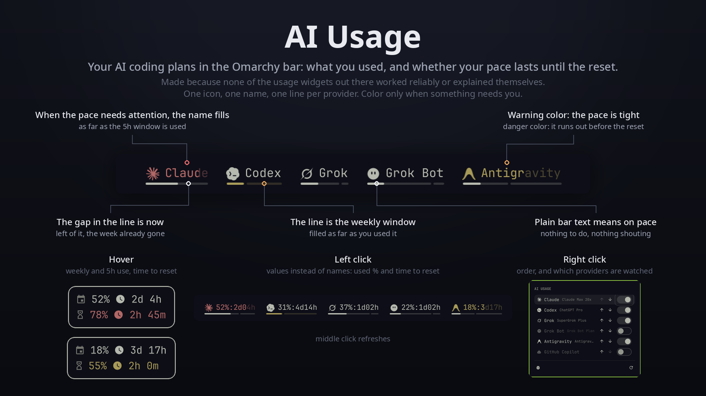
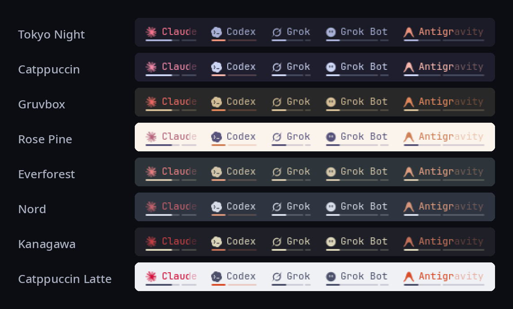

# AI Usage

An Omarchy bar widget that shows, for each AI coding plan ai-usagebar supports and finds on the machine, how much of the weekly limit and of the short (5h) window is used, and whether the current pace reaches the reset without hitting the limit.

I wrote it because none of the usage widgets I tried worked reliably, and none of them made it clear at a glance what was going on. This one is visual first: one icon, one name and one thin line per provider, plain bar text while the pace is fine, and color only when something needs attention.



It takes its colors from the active theme:



## Reading it

- **The line** under each provider is the weekly window. The filled part is what you used. The small gap is "now": left of it is the part of the week already gone, right of it is the time left until the reset. If the fill ends before the gap, you are using less than time passes.
- **The icon and the name** carry the short window (5h, when the provider has one). In normal use they look like the rest of the bar. When the pace turns, the icon takes the warning or danger color and the name fills with it from left to right, as far as the share already used.
- **Colors** come from the active theme: normal is the bar text color, warning is the theme's `orange` (or its `yellow` when that stands out from the text color, else the accent), danger is the theme's red.
- **Pace** is `used / elapsed`, with elapsed floored at 10% so a fresh window does not jump. Warning starts at a projected 85%, danger at 100% or when the window is exhausted.
- **Which windows**: the line shows the provider's worst window of 7 days or more (a monthly cycle counts too), the icon and name its worst shorter one. Per-model pools, such as Antigravity's, are used for a window only when the provider reports no shared one of that length. A metric with no known window length, like a balance, is judged on its percentage alone and drawn without the "now" gap.
- **Grok and Grok Bot** share one weekly pool on The X Subscription (and on a SuperGrok plan linked in Grok Bot). When both report the same weekly reset they show as a single Grok, at the higher of the two readings. Grok Bot on its own Cursor grant resets on another schedule and keeps its own button.
- **A dimmed provider** (while you are not hovering another one) has a problem: stale data, a rate limit, an expired login, no network. A provider whose fetch fails with no data at all still shows up, dimmed, so the problem stays visible.

Hovering a provider dims the others and opens a tooltip: `󰃭` weekly and `󰔟` 5h rows with the percentage used and `󰥔` the time to reset. When something is wrong, a top row names it: `󰌾 needs auth`, `󰓅 rate limited · retry in 4m`, `󰖪 offline`, `󰀦 error` or `󰗎 stale data`.

## Clicks and keys

- Left click: switch between icon + name and icon + values (`47%:2d02h`, weekly use and time to reset). The values keep the coloring of the short window, like the name.
- Middle click: refresh now.
- Right click: the configurator, to reorder providers and choose which ones are monitored. It lists every provider ai-usagebar has a login for or has enabled. Up and down select a row, left and right move it, space turns monitoring on or off, Esc closes. The refresh icon at the bottom scans again for providers you signed in to since the shell started.

Without a custom order, providers are sorted by subscription price, most expensive first.

## Requirements

All fetching, caching and rate-limit backoff is done by [ai-usagebar](https://github.com/akitaonrails/ai-usagebar):

```sh
omarchy pkg aur add ai-usagebar-bin
```

The widget itself makes no network requests. It runs `ai-usagebar usage --json` every 5 minutes by default (`refreshIntervalSec`, never less than 300 seconds, the interval ai-usagebar recommends for the Claude and Codex endpoints) and reads ai-usagebar's cache to explain a stale provider. Countdowns and colors update every 30 seconds without any request.

Things to know before installing:

- On start the widget runs `ai-usagebar detect`, and a scan from the configurator runs `ai-usagebar detect --all`. Both turn on, in `~/.config/ai-usagebar/config.toml`, the providers whose credentials it can find on the machine (CLI logins, keyrings, saved keys, environment variables), so existing logins show up without configuration. A few providers in ai-usagebar are opt-in only and are never turned on this way.
- Turning a provider off in the configurator disables it in ai-usagebar (`ai-usagebar settings apply`), so it is not polled at all. It also disappears from ai-usagebar's own TUI. `detect` never turns it back on.
- ai-usagebar refreshes expired Claude and Codex OAuth tokens and writes them back to `~/.claude/.credentials.json` and `~/.codex/auth.json`.

## Install

```sh
omarchy plugin add https://github.com/dobrician/omarchy-ai-usage --enable
```

The widget lands in the left section of the bar. Move it with `omarchy bar move dc.ai-usage --section <left|center|right>`, or with the bar's own drag and drop. It needs the stock Omarchy bar at the top or the bottom of the screen; on a left or right bar, or under a third-party replacement bar, it shows only a placeholder icon.

To remove it:

```sh
omarchy plugin remove dc.ai-usage
```

This leaves ai-usagebar and its config as they are, including the providers `detect` turned on and the ones you turned off.

## Settings

Stored on the widget's entry in `~/.config/omarchy/shell.json`:

| Key | Default | Meaning |
|---|---|---|
| `displayMode` | `name` | `name` or `values` |
| `refreshIntervalSec` | `300` | 300 to 3600 seconds |
| `providerOrder` | by price | array of ai-usagebar provider ids |
| `binary` | `ai-usagebar` | path to the ai-usagebar binary |

The widget also answers IPC, for keybindings or scripts:

```sh
omarchy-shell dc.ai-usage refresh
omarchy-shell dc.ai-usage scan
omarchy-shell dc.ai-usage toggleMode
omarchy-shell dc.ai-usage openSettings
omarchy-shell dc.ai-usage status
```

## Development

```sh
node --test tests/
```

The tests cover the model: parsing ai-usagebar's output, choosing the weekly and short windows, pace, ordering, formatting and problem detection. `tests/fake-ai-usagebar` stands in for ai-usagebar in the bar: point `binary` at it and choose its behavior in `~/.cache/dc.ai-usage/fake-mode` (`ok`, `states`, `preview`, `slow`, `fail`, `garbage`, `apply-fail`). If a change to `Service.qml` does not show up after saving, run `omarchy restart shell`.

## Credits

- Usage data: [ai-usagebar](https://github.com/akitaonrails/ai-usagebar) by Fabio Akita.
- Claude and Codex marks are adapted from the [Omarchy](https://github.com/basecamp/omarchy) agents widget, Grok and Antigravity marks come from [Lobe Icons](https://github.com/lobehub/lobe-icons), both MIT; the Grok Bot mark is drawn after the app icon. Notices are in [NOTICE](NOTICE). All marks belong to their owners.

## License

MIT
